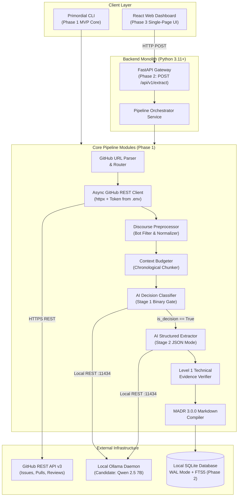
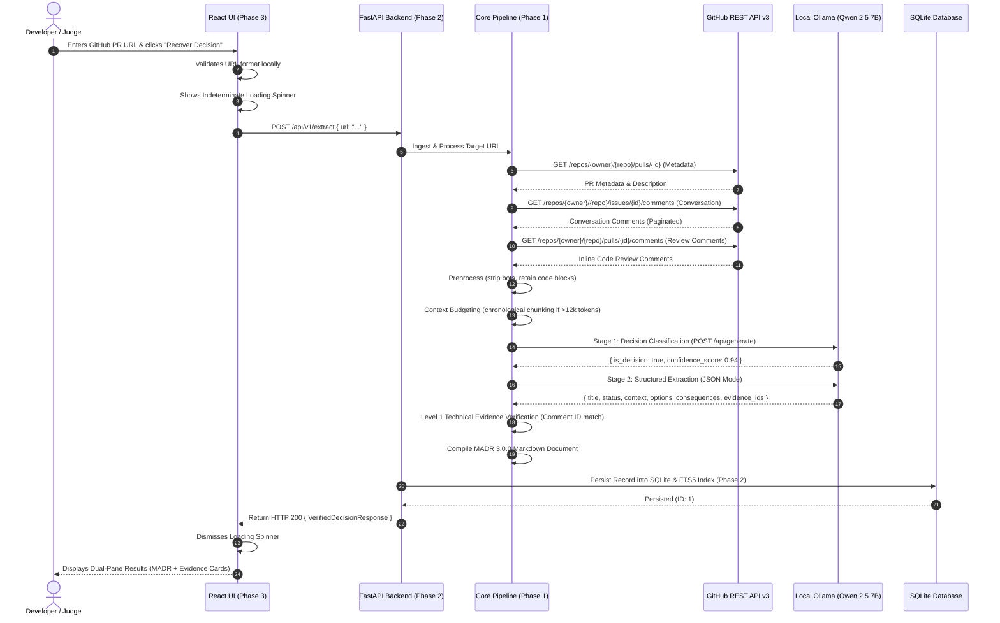
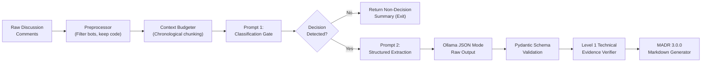
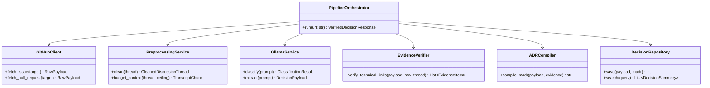

# Primordial: System Architecture and Implementation Design (Corrected)

**Document Identifier:** `PRIMORDIAL-DOC-05-REV2`  
**Project:** Primordial — Open Source Decision Intelligence and Knowledge Recovery  
**Repository:** `primordial-hacktoberfest`  
**Team Members:** Shaurya Negi, Prince Chhikara, Manisha Jain  
**Hackathon:** Hacktoberfest 2026 – Hack Day Sonipat  
**Institution:** Newton School of Technology, Rishihood University  
**Problem Statement:** Problem Statement 06 — Open Source Decision Intelligence and Knowledge Recovery  
**Documentation Version:** 2.0.0 (Implementation-Ready Revision)

---

## Table of Contents

1. [Architectural Principles & Phased Stack Progression](#1-architectural-principles--phased-stack-progression)
   - [Development Order: Phase 1 CLI → Phase 2 API → Phase 3 Web](#development-order-phase-1-cli--phase-2-api--phase-3-web)
   - [Technology Stack Evaluation Matrix](#technology-stack-evaluation-matrix)
   - [Architectural Decision Registry (Confirmed vs. Pending)](#architectural-decision-registry-confirmed-vs-pending)
2. [Open-Weight AI Model Selection & Evaluation Plan](#2-open-weight-ai-model-selection--evaluation-plan)
   - [Candidate Model Comparison Matrix](#candidate-model-comparison-matrix)
   - [Candidate Model & Fallback Strategy](#candidate-model--fallback-strategy)
   - [Hardware Requirements & Ollama Execution](#hardware-requirements--ollama-execution)
   - [Empirical Model Evaluation Plan](#empirical-model-evaluation-plan)
3. [System Architecture Diagrams](#3-system-architecture-diagrams)
   - [High-Level System Architecture](#high-level-system-architecture)
   - [End-to-End Synchronous Request Sequence](#end-to-end-synchronous-request-sequence)
   - [AI Pipeline Dataflow Diagram](#ai-pipeline-dataflow-diagram)
   - [Component Interaction Diagram](#component-interaction-diagram)
4. [Backend Architecture & Module Specification](#4-backend-architecture--module-specification)
   - [Standardized Directory Structure](#standardized-directory-structure)
   - [Module Responsibilities & Interfaces](#module-responsibilities--interfaces)
   - [Pydantic Domain Models](#pydantic-domain-models)
   - [Relational Database Schema (SQLite / SQLModel)](#relational-database-schema-sqlite--sqlmodel)
   - [Environment Configuration & Variables](#environment-configuration--variables)
5. [API Specification & Contract](#5-api-specification--contract)
6. [Frontend Architecture & UI Design (Phase 3)](#6-frontend-architecture--ui-design-phase-3)
   - [Component Hierarchy](#component-hierarchy)
   - [Synchronous Loading & State Management](#synchronous-loading--state-management)
   - [Fallback UI Strategy](#fallback-ui-strategy)
7. [Security, Token Handling & Deployment Considerations](#7-security-token-handling--deployment-considerations)

---

## 1. Architectural Principles & Phased Stack Progression

Primordial is designed around five core engineering principles:

1. **Local-First & Open-Weight:** Core decision intelligence must execute completely on consumer-grade hardware using open-weight models without transmitting repository data to paid cloud APIs.
2. **Modular Monolith over Microservices:** For a 3-member student hackathon team, distributed microservices introduce unnecessary deployment lag and networking failures. A well-factored Python monolith guarantees velocity.
3. **Strict Schema Determinism:** Free-form LLM outputs are prohibited. Every AI extraction step must validate against strongly typed Pydantic models.
4. **Verifiable Provenance:** Every architectural assertion must link back to an authentic, immutable GitHub comment ID.
5. **Zero Infrastructure Overhead:** SQLite with Write-Ahead Logging (WAL) delivers microsecond query speeds and ACID transactions without requiring a standalone database server.

---

### Development Order: Phase 1 CLI → Phase 2 API → Phase 3 Web

To guarantee a working demonstration for Hacktoberfest, the team follows a strict three-phase progression:

- **Phase 1: Core Backend & CLI (MVP Core Target):**
  - Implement GitHub URL validation and REST API ingestion.
  - Discussion preprocessing and chronological context chunking.
  - Decision detection (Stage 1) and structured extraction (Stage 2) using Ollama.
  - Level 1 technical evidence verification.
  - MADR 3.0.0 Markdown compiler.
  - Expose via command-line executable (`python -m app.cli extract <url>`).
- **Phase 2: Backend API Service:**
  - Wrap the core pipeline in a FastAPI web service (`POST /api/v1/extract`).
  - Add SQLite persistence (WAL mode) and FTS5 search.
  - Implement health check and rate-limit reporting.
- **Phase 3: React Web Dashboard (Later Phase):**
  - Build a React + Vite + Tailwind CSS Single Page Application.
  - Connect to the tested Phase 2 API.
  - Provide an indeterminate loading spinner for synchronous extraction.
  - Dual-pane results viewer: formatted MADR on the left, evidence cards on the right.

The React frontend is **not** a prerequisite for the initial working MVP.

---

### Technology Stack Evaluation Matrix

```
+---------------------------------------------------------------------------------------------------------------+
|                                      TECH STACK EVALUATION MATRIX                                             |
+-------------------+----------------------------+-----------------------------+--------------------------------+
| Layer             | Evaluated Options          | Selected Option             | Selection Justification        |
+-------------------+----------------------------+-----------------------------+--------------------------------+
| Backend Runtime   | Python 3.11+ vs. Go vs.    | Python 3.11+                | Native ecosystem for LLM libs  |
|                   | Node.js / TypeScript       |                             | (Ollama, Pydantic, Jinja2)     |
+-------------------+----------------------------+-----------------------------+--------------------------------+
| Web API Framework | FastAPI vs. Flask vs.      | FastAPI (Phase 2)           | Async I/O, native Pydantic v2, |
|                   | Django Ninja               |                             | auto OpenAPI documentation     |
+-------------------+----------------------------+-----------------------------+--------------------------------+
| HTTP Client       | httpx vs. requests vs.     | httpx (Async)               | Non-blocking GitHub API calls; |
|                   | aiohttp                    |                             | modern connection pooling      |
+-------------------+----------------------------+-----------------------------+--------------------------------+
| Database          | SQLite (WAL) vs.           | SQLite (WAL Mode) (Phase 2) | Zero daemon setup; single-file |
|                   | PostgreSQL                 |                             | persistence; embedded FTS5     |
+-------------------+----------------------------+-----------------------------+--------------------------------+
| AI Local Runtime  | Ollama vs. vLLM vs.        | Ollama                      | Simple setup, REST API, native |
|                   | llama.cpp CLI              |                             | JSON schema format mode        |
+-------------------+----------------------------+-----------------------------+--------------------------------+
| Primary Frontend  | React (Vite) + Tailwind    | React + Vite + Tailwind CSS | Rapid prototyping; interactive |
|                   | vs. Next.js vs. Jinja2     | (Phase 3)                   | state for evidence drawer      |
+-------------------+----------------------------+-----------------------------+--------------------------------+
```

---

### Architectural Decision Registry (Confirmed vs. Pending)

```
+-------------------------------------------------------------------------------------------------------------------+
|                                      ARCHITECTURAL DECISION REGISTRY                                              |
+----+--------------------------+---------------------+----------------------------+-------------------+------------+
| ID | Decision Title           | Selected Option     | Alternative Considered     | Trade-off / Risk  | Status     |
+----+--------------------------+---------------------+----------------------------+-------------------+------------+
| 01 | Primary Delivery Interface| CLI First (Phase 1) | React Dashboard First      | Deferring web UI  | CONFIRMED  |
|    |                          |                     |                            | protects MVP date |            |
| 02 | Extraction Processing    | Synchronous HTTP    | Asynchronous Job Queue     | Long threads may  | CONFIRMED  |
|    | Model (API)              | POST /api/v1/extract| with Redis & Polling       | take 30-45s in MVP| (for MVP)  |
| 03 | Background Job Queue     | Defer to Post-Hack  | Celery + Redis / RabbitMQ  | Avoids distributed| PENDING    |
|    | for Async Extraction     |                     |                            | infrastructure    | (Post-Hack)|
| 04 | Database Engine          | SQLite (WAL Mode)   | PostgreSQL                 | Single node only; | CONFIRMED  |
|    |                          |                     |                            | zero ops overhead |            |
| 05 | GitHub Auth Storage      | Backend .env only   | Client X-GitHub-Token hdr  | Token never leaks | CONFIRMED  |
|    |                          |                     |                            | to browser code   |            |
| 06 | Context Truncation Model | Chronological Chunk | First 5 + Last 15 Comments | Chunks avoid bias;| CONFIRMED  |
|    |                          | with Decision Signal|                            | reports truncation|            |
| 07 | Candidate AI Model       | Qwen 2.5 7B Instruct| Llama 3.1 8B Instruct      | Exact throughput  | PENDING    |
|    |                          | (qwen2.5:7b)        |                            | to be benchmarked | (Benchmarking)|
+----+--------------------------+---------------------+----------------------------+-------------------+------------+
```

---

## 2. Open-Weight AI Model Selection & Evaluation Plan

### Candidate Model Comparison Matrix

> **Note on Performance Metrics:** Hardware-dependent benchmarks (tokens/second, exact RAM footprint) vary based on test machines and are marked **PENDING** until empirically measured on the team's demonstration hardware.

```
+-------------------------------------------------------------------------------------------------------------------+
|                                      CANDIDATE MODEL COMPARISON MATRIX                                            |
+---------------------+-------------------+-------------------+------------------------+----------------------------+
| Metric / Criteria   | Qwen 2.5 7B       | Llama 3.1 8B      | Gemma 2 9B             | Mistral 7B (v0.3)          |
|                     | Instruct (q4_K_M) | Instruct (q4_K_M) | Instruct (q4_K_M)      | Instruct (q4_K_M)          |
+---------------------+-------------------+-------------------+------------------------+----------------------------+
| Parameter Count     | 7.6 Billion       | 8.0 Billion       | 9.2 Billion            | 7.2 Billion                |
| Native Context      | 32,768 tokens     | 131,072 tokens    | 8,192 tokens           | 32,768 tokens              |
| RAM/VRAM Footprint  | ~4.7 GB (Weights) | ~4.9 GB (Weights) | ~5.6 GB (Weights)      | ~4.4 GB (Weights)          |
| JSON Mode Support   | Native in Ollama  | Native in Ollama  | Native in Ollama       | Native in Ollama           |
| Software Reasoning  | Strong            | Strong            | Strong                 | Strong                     |
| License             | Apache-2.0        | Llama 3.1 License | Gemma Terms of Use     | Apache-2.0                 |
| Exact Ollama Tag    | `qwen2.5:7b`      | `llama3.1:8b`     | `gemma2:9b`            | `mistral:7b`               |
| Inference Speed     | PENDING (Bench)   | PENDING (Bench)   | PENDING (Bench)        | PENDING (Bench)            |
+---------------------+-------------------+-------------------+------------------------+----------------------------+
```

### Candidate Model & Fallback Strategy

- **Primary Candidate: `qwen2.5:7b` (`qwen2.5:7b-instruct-q4_K_M`)**
  - **Justification:** Licensed under **Apache-2.0**, fits inside ~4.7 GB memory, supports structured JSON mode reliably, and possesses strong technical instruction following.
  - **Clarification:** `qwen2.5:7b` and `qwen2.5:7b-instruct` are distinct tags; the team standardizes on the official Ollama instruct release: `ollama pull qwen2.5:7b`.
- **Secondary Fallback: `llama3.1:8b` (`llama3.1:8b-instruct-q4_K_M`)**
  - Supported via configuration switch (`AI_MODEL=llama3.1:8b`) if a test machine already has Llama 3.1 pulled.

### Hardware Requirements & Ollama Execution

- **Minimum Hardware:**
  - 8 GB Unified Memory (Apple Silicon M1/M2/M3/M4) OR 8 GB VRAM NVIDIA GPU (GTX 1080 / RTX 2060+) OR 16 GB System RAM (CPU inference via AVX2).
- **Execution Setup:**
  ```bash
  # 1. Install Ollama
  curl -fsSL https://ollama.com/install.sh | sh

  # 2. Pre-pull the candidate model
  ollama pull qwen2.5:7b

  # 3. Verify running service
  curl http://localhost:11434/api/tags
  ```

### Empirical Model Evaluation Plan

To confirm the candidate model before final presentation, the team will execute a benchmark on three representative discussions:
1. **Node.js Fetch PR (#41749):** Complex debate with accepted and rejected options.
2. **Next.js Turbopack Issue (#41745):** Multi-threaded discussion with community feedback.
3. **React Bug Fix Issue (#12345):** Negative control test (routine bug fix).

**Evaluation Dimensions:**
- Valid JSON format output (100% parse success required).
- Decision detection accuracy (positive on #1 and #2, negative on #3).
- Rationale extraction fidelity (correct identification of options).
- Evidence ID association (correct mapping of comment IDs).
- End-to-end inference latency (seconds).
- Peak memory usage (GB).

---

## 3. System Architecture Diagrams

### High-Level System Architecture



---

### End-to-End Synchronous Request Sequence



---

### AI Pipeline Dataflow Diagram



---

### Component Interaction Diagram



---

## 4. Backend Architecture & Module Specification

### Standardized Directory Structure

```text
primordial/
├── backend/
│   ├── app/
│   │   ├── __init__.py
│   │   ├── cli.py                  # Phase 1 CLI Entrypoint
│   │   ├── main.py                 # Phase 2 FastAPI Application Entrypoint
│   │   ├── api/
│   │   │   ├── __init__.py
│   │   │   ├── router.py           # Top-level API router (/api/v1)
│   │   │   └── endpoints/
│   │   │       ├── extract.py      # POST /api/v1/extract (synchronous)
│   │   │       ├── decisions.py    # GET /api/v1/decisions (listing & FTS5 search)
│   │   │       └── health.py       # GET /api/v1/health
│   │   ├── core/
│   │   │   ├── config.py           # Pydantic BaseSettings, .env loader
│   │   │   ├── exceptions.py       # Custom exception hierarchy
│   │   │   └── logging.py          # Structured logging configuration
│   │   ├── domain/
│   │   │   ├── __init__.py
│   │   │   ├── schemas.py          # Canonical Pydantic domain models
│   │   │   └── entities.py         # Internal dataclasses & Enums
│   │   ├── github/
│   │   │   ├── parser.py           # URL validation & regex parser
│   │   │   ├── router.py           # Entity router (issues vs pull)
│   │   │   ├── client.py           # Async httpx client with rate limit handler
│   │   │   └── normalizer.py       # Canonical comment stream builder
│   │   ├── preprocessing/
│   │   │   ├── cleaner.py          # Bot filter, signature & noise stripper
│   │   │   └── budgeter.py         # Chronological chunking & token budgeter
│   │   ├── ai/
│   │   │   ├── ollama_client.py    # Ollama REST connector (JSON mode)
│   │   │   ├── prompts.py          # Stage 1 and Stage 2 prompt templates
│   │   │   ├── classifier.py       # Stage 1 binary decision gate
│   │   │   ├── extractor.py        # Stage 2 structured rationale extractor
│   │   │   └── verifier.py         # Level 1 technical evidence verifier
│   │   ├── adr/
│   │   │   ├── compiler.py         # MADR 3.0.0 Jinja2 generator
│   │   │   └── templates/
│   │   │       └── madr_template.md# Standard MADR 3.0.0 layout
│   │   ├── storage/                # Phase 2 Storage
│   │   │   ├── database.py         # SQLite connection & WAL mode config
│   │   │   ├── models.py           # SQLModel database tables
│   │   │   └── repository.py       # CRUD & SQLite FTS5 search queries
│   │   └── services/
│   │       └── orchestrator.py     # Master 12-stage pipeline orchestrator
│   ├── requirements.txt            # Pinned Python dependencies
│   ├── .env.example                # Template environment variables
│   └── pytest.ini                  # Pytest configuration
├── frontend/                       # Phase 3 React Application
├── examples/                       # Reference fixtures & sample outputs
├── tests/                          # Automated Pytest suite
└── docs/                           # Documentation & MADR records
```

---

### Module Responsibilities & Interfaces

- **`app.cli` (Phase 1):** Command-line entrypoint. Uses `argparse` to parse `--output`, `--format`, and `--fixture` options, invokes `orchestrator.run()`, and prints results.
- **`app.services.orchestrator`:** Master controller coordinating stages 1 through 12 synchronously.
- **`app.github.client`:** Encapsulates all GitHub REST API communication. Reads `GITHUB_TOKEN` from backend environment, handles pagination, and monitors rate limits.
- **`app.preprocessing.budgeter`:** Manages chronological chunking when conversations exceed 12,000 tokens and records truncation metadata.
- **`app.ai.ollama_client`:** Asynchronous client for Ollama API (`localhost:11434`), enforcing JSON schema format mode.
- **`app.ai.verifier`:** Executes Level 1 technical verification, validating that cited comment IDs and permalinks physically exist in the fetched discussion.
- **`app.storage.repository` (Phase 2):** Manages SQLite WAL storage and FTS5 search queries.

---

### Pydantic Domain Models

The backend domain models match the canonical schema defined in Document 03:

```python
# backend/app/domain/schemas.py
from datetime import datetime
from enum import Enum
from typing import List, Optional
from pydantic import BaseModel, Field

class DecisionStatus(str, Enum):
    ACCEPTED = "accepted"
    REJECTED = "rejected"
    PROPOSED = "proposed"
    SUPERSEDED = "superseded"
    INSUFFICIENT_EVIDENCE = "insufficient_evidence"

class OptionStatus(str, Enum):
    CHOSEN = "chosen"
    REJECTED = "rejected"
    UNRESOLVED = "unresolved"

class ExtractRequest(BaseModel):
    url: str = Field(..., example="https://github.com/nodejs/node/pull/41749")
    force_refresh: bool = False

class ChosenOption(BaseModel):
    name: str
    description: str
    evidence_ids: List[str] = Field(default_factory=list)

class ConsideredOption(BaseModel):
    name: str
    status: OptionStatus
    rejection_reason: Optional[str] = None
    evidence_ids: List[str] = Field(default_factory=list)

class Consequences(BaseModel):
    positive: List[str] = Field(default_factory=list)
    negative: List[str] = Field(default_factory=list)

class DecisionPayload(BaseModel):
    title: str
    status: DecisionStatus
    context_and_problem: str
    decision_drivers: List[str] = Field(default_factory=list)
    chosen_option: Optional[ChosenOption] = None
    considered_options: List[ConsideredOption] = Field(default_factory=list)
    consequences: Consequences = Field(default_factory=Consequences)

class EvidenceItem(BaseModel):
    comment_id: str
    author: str
    timestamp: datetime
    html_url: str
    claim_supported: str
    verbatim_excerpt: Optional[str] = None
    is_technically_verified: bool = True

class ClassificationResult(BaseModel):
    is_decision: bool
    confidence_score: float = Field(..., ge=0.0, le=1.0)
    reasoning: str

class ContextProcessingMetadata(BaseModel):
    total_comments_ingested: int
    substantive_comments_retained: int
    was_truncated: bool
    processing_note: Optional[str] = None

class VerifiedDecisionResponse(BaseModel):
    extraction_id: str
    repository: str
    source_url: str
    entity_type: str
    entity_number: int
    extracted_at: datetime
    classification: ClassificationResult
    decision: Optional[DecisionPayload] = None
    evidence_catalog: List[EvidenceItem] = Field(default_factory=list)
    context_metadata: ContextProcessingMetadata
    madr_content: Optional[str] = None
```

---

### Relational Database Schema (SQLite / SQLModel)

```python
# backend/app/storage/models.py
from datetime import datetime
from typing import Optional
from sqlmodel import Field, SQLModel

class DecisionRecord(SQLModel, table=True):
    __tablename__ = "decisions"

    id: Optional[int] = Field(default=None, primary_key=True)
    extraction_id: str = Field(index=True, unique=True)
    repository: str = Field(index=True)
    entity_type: str
    entity_number: int
    source_url: str
    title: str
    status: str
    context_and_problem: str
    chosen_option_name: Optional[str] = None
    madr_markdown: str
    confidence_score: float
    was_truncated: bool = False
    extracted_at: datetime = Field(default_factory=datetime.utcnow)

class EvidenceRecord(SQLModel, table=True):
    __tablename__ = "evidence_records"

    id: Optional[int] = Field(default=None, primary_key=True)
    decision_id: int = Field(foreign_key="decisions.id", index=True)
    comment_id: str
    author: str
    html_url: str
    claim_supported: str
    verbatim_excerpt: Optional[str] = None
    is_technically_verified: bool = True
```

---

### Environment Configuration & Variables

```ini
# backend/.env.example
APP_ENV=development
APP_PORT=8000
APP_HOST=0.0.0.0

# GitHub API Token (Read-only; increases limit from 60 to 5,000 req/hr)
GITHUB_TOKEN=

# AI Model Configuration
OLLAMA_BASE_URL=http://localhost:11434
AI_MODEL_PRIMARY=qwen2.5:7b
AI_MODEL_FALLBACK=llama3.1:8b
AI_TIMEOUT_SECONDS=90

# Database Configuration (Phase 2)
DATABASE_URL=sqlite:///./primordial.db
ENABLE_WAL_MODE=True

# Demonstration Fallback (Set True if internet is unavailable during live judging)
ENABLE_OFFLINE_DEMO_FIXTURES=False
```

---

## 5. API Specification & Contract

### 1. `POST /api/v1/extract`
- **Method:** `POST`
- **URL:** `/api/v1/extract`
- **Purpose:** Ingests a GitHub discussion URL, synchronously executes the extraction pipeline, persists to SQLite, and returns the response envelope.
- **Request Body:**
  ```json
  {
    "url": "https://github.com/nodejs/node/pull/41749",
    "force_refresh": false
  }
  ```
- **Response (200 OK):** Returns `VerifiedDecisionResponse`.
- **Possible Status Codes:**
  - `200 OK`: Extraction completed successfully.
  - `400 Bad Request`: Malformed GitHub URL syntax.
  - `404 Not Found`: Repository or discussion does not exist.
  - `422 Unprocessable Entity`: Discussion is empty or contains only bots.
  - `429 Too Many Requests`: GitHub rate limit reached.
  - `503 Service Unavailable`: Local Ollama service is unreachable.

### 2. `GET /api/v1/decisions`
- **Method:** `GET`
- **URL:** `/api/v1/decisions`
- **Purpose:** Lists previously extracted decisions with full-text search and filtering.
- **Query Parameters:** `query` (string), `repo` (string), `status` (string).
- **Response (200 OK):** List of decision summary records.

### 3. `GET /api/v1/decisions/{id}`
- **Method:** `GET`
- **URL:** `/api/v1/decisions/{id}`
- **Purpose:** Retrieves the full JSON record and evidence catalog for a specific decision.

### 4. `GET /api/v1/decisions/{id}/adr`
- **Method:** `GET`
- **URL:** `/api/v1/decisions/{id}/adr`
- **Purpose:** Downloads the raw MADR 3.0.0 Markdown document (`Content-Type: text/markdown`).

### 5. `GET /api/v1/health`
- **Method:** `GET`
- **URL:** `/api/v1/health`
- **Purpose:** Verifies backend status, SQLite database connection, and Ollama service availability.

---

## 6. Frontend Architecture & UI Design (Phase 3)

### Component Hierarchy

```text
App
├── Header (Branding, GitHub status badge)
├── MainContent
│   ├── SearchSection (URL input bar, quick sample selector, Extract button)
│   ├── LoadingSection (Indeterminate spinner with time explanation)
│   ├── ErrorAlert (Dismissible alerts for rate limits or 404s)
│   └── ResultsSection (Visible upon successful extraction)
│       ├── ResultsHeader (Title, status pill, repository badge, export buttons)
│       └── SplitPaneContainer
│           ├── LeftPane: AdrViewer (Rendered MADR 3.0.0 Markdown preview)
│           └── RightPane: EvidenceDrawer (Interactive cards with permalinks)
└── DecisionRegistryModal (Searchable library of past saved ADRs)
```

### Synchronous Loading & State Management

Because the MVP backend executes synchronously, the frontend does not poll status endpoints or stream SSE events:
1. User clicks **"Recover Decision"**.
2. Frontend transitions state: `status = "loading"`.
3. An indeterminate loading spinner is displayed with clear messaging:
   *"Analyzing discussion using local AI model. This typically takes 20–45 seconds depending on discussion length..."*
4. On HTTP 200 response, state transitions to `status = "completed"` and renders results.
5. On HTTP error, state transitions to `status = "error"` and renders error toast.

### Fallback UI Strategy

If unforeseen npm build issues occur during hackathon setup:
- The FastAPI backend includes a pre-packaged single-file HTML5/Tailwind CDN template served from `GET /`. This ensures the application remains demonstrable even if the Node.js build toolchain fails.

---

## 7. Security, Token Handling & Deployment Considerations

1. **Token Protection:** The `GITHUB_TOKEN` is stored exclusively in the backend `.env` file. It is never exposed in frontend code, never transmitted over client HTTP headers, and never written to database tables.
2. **Read-Only Operations:** Primordial possesses no API methods for creating or modifying issues, PRs, or comments on external repositories.
3. **Prompt Injection Mitigation:** Discussion comments are treated as untrusted text and isolated within `<transcript>` XML tags. System instructions explicitly prohibit executing commands embedded inside comment bodies.
4. **Markdown Sanitization:** Rendered Markdown in the web dashboard is sanitized to prevent Cross-Site Scripting (XSS).
5. **Local Deployment:**
   ```bash
   # Terminal 1: Launch Ollama
   ollama serve

   # Terminal 2: Run CLI (Phase 1 MVP)
   cd backend && python -m app.cli extract https://github.com/nodejs/node/pull/41749

   # Terminal 3: Run FastAPI (Phase 2)
   cd backend && uvicorn app.main:app --reload --port 8000

   # Terminal 4: Run Frontend (Phase 3)
   cd frontend && npm run dev
   ```
